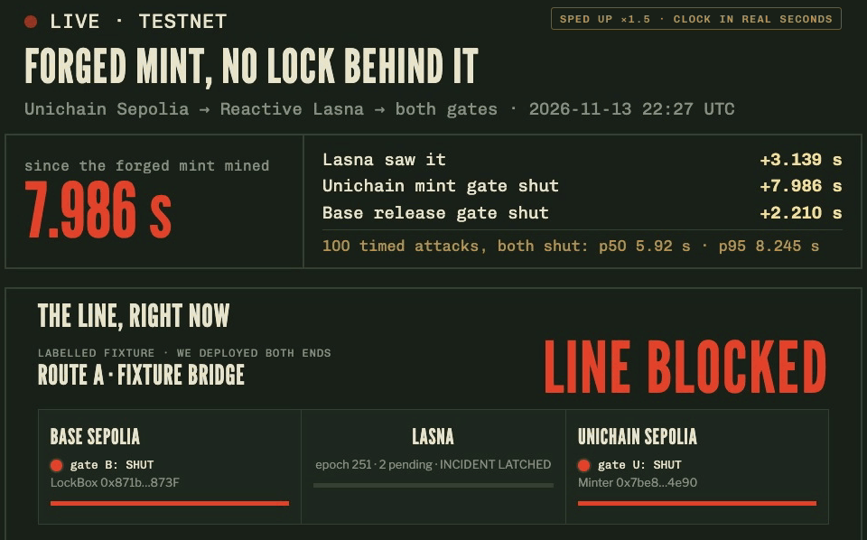
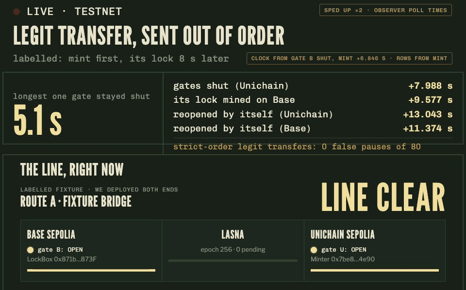
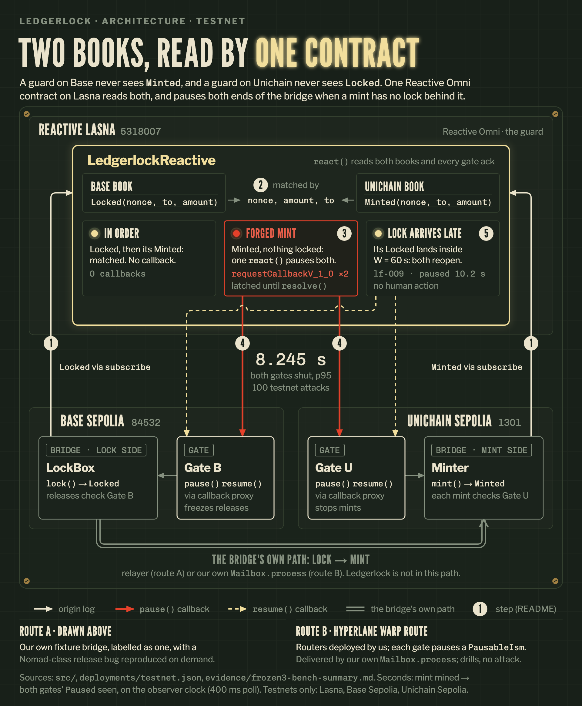
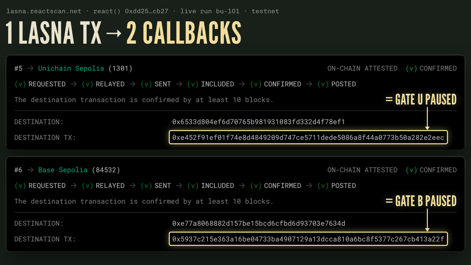
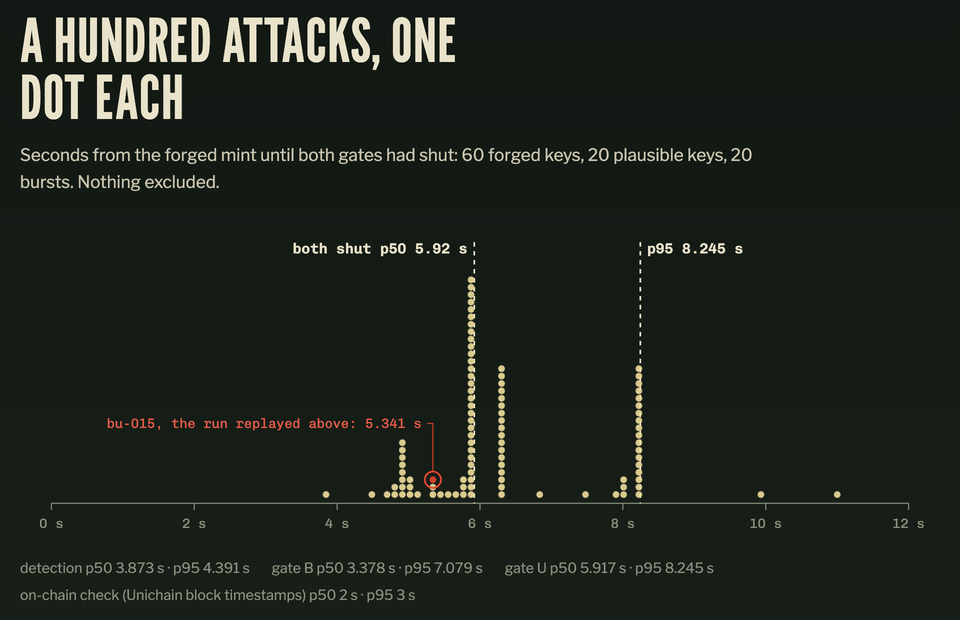

<div align="center">
  
  <h1>Ledgerlock ⛓️‍💥</h1>
  <p><em>Two chains, one book: pause a bridge seconds after it mints what was never locked.</em></p>
  
  <p><b>One Reactive Omni contract on Lasna sees Base <code>Locked</code> and Unichain <code>Minted</code> together, which a contract on either chain cannot.</b> Over 100 forged-mint attacks on our own fixture bridge, both gates' <code>Paused</code> blocks land <b>2 s</b> (p50) and <b>3 s</b> (p95) after the mint's block (block timestamps, whole seconds, two chains' clocks; the Base gate alone p50 1 s). In 20 of 20 bursts the next copycat reverted <code>GatePaused</code>, and <b>0 of 80</b> in-order legitimate transfers paused. Seen by a polling observer through public RPCs (400 ms poll, includes RPC lag): the mint reaches Lasna in 3.9 s (p50) and both gates read shut by 5.9 s (p50) / 8.2 s (p95). Regenerate from the committed rows: <code>pnpm bench:summary</code>.</p>

  <br/>

  [](https://ledgerlock.edycu.dev/judge)
  [](https://ledgerlock.edycu.dev/)
  [](https://ledgerlock.edycu.dev/pitch/)
  [](https://youtu.be/ijFfcDMhkxc)
  [](https://dorahacks.io/hackathon/reactive-omni-buildathon/detail)

  <br/>

  
  
  
  [](LICENSE)
  [](https://github.com/edycutjong/ledgerlock/actions/workflows/ci.yml)
  [](https://github.com/edycutjong/ledgerlock/releases/latest)

  <p><b>Judging?</b> Start at <a href="https://ledgerlock.edycu.dev/judge">/judge</a> (<a href="JUDGE.md">JUDGE.md</a>): one forged mint, one Lasna <code>react()</code>, both gates paused, the copycat reverted, in six explorer links. No wallet needed.</p>

</div>

---

## 📸 See it in Action

<p align="center"></p>
<p align="center"><em>Real testnet run bu-101 (2026-11-13), recorded on camera while the bench harness ran, sped up ×1.5: the real status page under the harness's observer times (<code>evidence/video-live-oncamera.log</code>). Those are first sightings through a 400 ms poll, so they are upper bounds and not causal order (Lasna is read on a different RPC); block timestamps put both gates shut at +2 s (<code>evidence/video-live-runs.md</code>).</em></p>

## 💡 The Problem & Solution

### The Problem
Lock-and-mint bridges fail by minting (or releasing) value that was never backed. When it happens, copycats replay the exploit every block until a human notices. The Nomad bridge lost about $190M this way, over roughly two and a half hours (Rekt, Immunefi). A guard has to see **both** chains, which a contract on one chain cannot do.

### The Solution
A reactive contract on Reactive Lasna keeps a ledger per route from the logs of both sides: `Locked` on Base Sepolia, `Minted` on Unichain Sepolia (and `Burned` / `Released` for the way back). The logic is inverted so the common case costs nothing:

- a `Minted` with no matching `Locked` pauses **both** gates from the same `react()`, via two callbacks;
- a matching `Locked` arriving inside the window `W` (60 s on our routes, set per route) reopens them automatically;
- a lock that arrives before its mint, and the mint that matches it, trigger no callback at all; only a lock that clears an unmatched mint sends the resume callbacks.

<p align="center"></p>
<p align="center"><em>Real testnet run lf-104 (2026-11-13), recorded on camera, sped up ×2: a legitimate transfer whose lock the harness sent 8 s after the mint (seen mined at +9.577 s) reopens both gates with no human action. The big clock counts from the first gate shut (gate B, mint +6.846 s) and the rows from the mint; 5.1 s is gate U's +7.988 s to +13.043 s.</em></p>

Each gate is a small contract that flips the bridge's own pause switch. **Why Omni:** a guard on Base never sees `Minted`, and a guard on Unichain never sees `Locked`; one Lasna contract reads both. An off-chain bot could watch both chains too, but it would need a key that can pause the bridge; here the automatic pause needs none: each gate's `pause()` and `resume()` accept only the callback proxy's delivery of this contract's request (`onlyServiceProvider` + `onlyCallbackSender` in `src/Gate.sol`); a guardian key exists for a manual pause, for lifting its own hold (it cannot lift an automated pause) and for binding the bridge component once (`setTarget`). We did not measure an off-chain watcher's latency on the same fixture. The claim we make is deliberately narrow: **loss ≤ the mints that land inside the measured pause window.** Ledgerlock does not stop the first unbacked mint.

## 🏗️ Architecture & Tech Stack



1. The bridge's own traffic: `Locked` on Base Sepolia, `Minted` on Unichain Sepolia. Both logs reach `LedgerlockReactive` on Lasna through `subscribe`.
2. `react()` matches each `Minted` to a `Locked` by nonce, amount and recipient. A matched pair sends no callback.
3. A `Minted` with no matching `Locked` makes that same `react()` request two callbacks (`requestCallbackV_1_0` ×2).
4. Both gates pause, one per chain (Gate B on Base, Gate U on Unichain); while shut, mints and releases revert `GatePaused`. Both were shut by 8.245 s (p95, 100 testnet attacks; mint mined to both gates' `Paused` seen, observer clock, 400 ms poll).
5. A matching `Locked` inside `W` (60 s) sends two `resume()` callbacks and both gates reopen. A forged or replayed key latches instead, until the owner's `resolve()`.

The diagram draws route A, our fixture bridge (`LockBox` on Base, `Minter` on Unichain). Route B, the Hyperlane warp route we deployed, swaps in Hyperlane's collateral and synthetic routers; each of its gates pauses a `PausableIsm` inside a 2-of-2 aggregation ISM, and its deliveries were made by our own `Mailbox.process`. Source: `docs/architecture/architecture.html` (inline SVG; the PNG above is its 2× render), built from `src/`, `deployments/testnet.json`, `evidence/frozen3-bench-summary.md` and, for the late-lock run `lf-104`, `evidence/video-live-runs.md`.

| Layer | Choice |
|---|---|
| Reactive contract | `src/LedgerlockReactive.sol`, `reactive-lib-omni`, Lasna 5318007 |
| Gates | `src/Gate.sol` (`AbstractCallback`) on Base Sepolia 84532 and Unichain Sepolia 1301 |
| Route A | our own fixture bridge (`src/fixture/LockBox.sol`, `Minter.sol`), labelled as a fixture, with a Nomad-class release bug reproduced on demand |
| Route B | a Hyperlane warp route we deployed (`PausableIsm` = Hyperlane's pausable interchain security module) (Base collateral → Unichain synthetic) with a `PausableIsm` behind the gate; deliveries were made by **our own `Mailbox.process`**, because the public relayer did not deliver within 6 minutes |
| Tests | Foundry with the Reactive Test Lib; scripts in TypeScript (viem) |
| Status page | static, `docs/status/`: reads live gate state and balances from public testnet RPCs, and lists the committed runs |

`tUSD` is the fixture's unit of account (internal bookkeeping, not an ERC-20) and lREACT is Lasna's gas token. Two guard instances: route A is guarded by `frozen3` (the final frozen deployment) and route B by `frozen` (its `PausableIsm` is owned by `frozen`'s gates, which have no ownership transfer). `frozen` (contract commit `388bd2c`) predates four `src/` commits that `frozen3` (`e425c78`) includes: re-sending a failed pause or resume leg, counting `CallbackFailure` only for our own current request, a new epoch for a re-armed cycle, saturating accumulators, one binding per (chain, emitter, topic), `setProxy` once per chain, and two SUPPLY-mode fixes (`resolve()` no longer sums the two deficit sides; a saturated source total counts as a deficit); route B's 10 legitimate transfers and 3 drills ran on that older bytecode. Per-route addresses: `deployments/testnet.json`.

## 🏆 Reactive Omni Integration

The reactive contract uses the Omni system contract directly (`src/LedgerlockReactive.sol`):

| Method | Use |
|---|---|
| `subscribe` | origin logs on both chains, each gate's `Paused` / `Resumed` / `HeldByGuardian`, and `CallbackFailure` on both callback proxies (`:233`, `:244`) |
| `requestCallbackV_1_0` | the pause / resume callbacks to the gates, gas limit 1,000,000 (`:520`) |
| `subscribe` / `unsubscribe` on the Cron10 topic | a runtime-only watchdog while a gate ack is outstanding (`:500`, `:536`) |
| `AbstractReactive` / `AbstractCallback` | base contracts for the reactive contract and the gates |

<p align="center"></p>
<p align="center"><em>The live <a href="https://lasna.reactscan.net/tx/0xdd2591adb689809394165bfa5ffbc440ec83553372b4c2f01999a55a790fcb27">Reactscan page</a> of bu-101's <code>react()</code>, captured 2026-11-16: one Lasna transaction, two callbacks; the header line, title, boxes and tags are annotations.</em></p>

No off-chain ingestion is used. One behaviour is not in Reactive's public docs: origin logs are read at the latest block, which the Reactive team told us in their dev Telegram on 8 Nov 2026 (we cannot publish that message here).

## ⛓️ Live Deployment

Testnet only; no wallet is needed to verify anything below, every item is a read-only lookup. Route A (`frozen3`, contract commit `e425c78`; `src/` and the kit sources at `HEAD` are byte-identical to that commit, so the code above is the code behind every route A row):

| Contract | Address |
|---|---|
| `LedgerlockReactive` (Lasna) | `0x1484bdBF890f3097069C95Dc55EB6C6BF9039Ff9` |
| Gate (Base Sepolia) | `0xE77A8068882d157bE15bcd6CfbD6D93703E7634d` |
| Gate (Unichain Sepolia) | `0x6533d804Ef6D70765b981931083Fd332D4F78ef1` |
| LockBox (Base Sepolia) / Minter (Unichain Sepolia) | `0x871b6da60da6Cf44482a055EE24031220021873F` / `0x7be8C4bf9De88Cc037F61203C8692E3514ec4e90` |

Landing page, pitch deck and read-only status page: <https://ledgerlock.edycu.dev/> (GitHub Pages from `docs/`; `/pitch/`, `/status/`). Route B's addresses are in `deployments/testnet.json`. Explorers: [Base Sepolia](https://sepolia.basescan.org), [Unichain Sepolia](https://sepolia.uniscan.xyz), [Lasna](https://lasna.reactscan.net).

Every pause is a triple: origin transaction → Lasna `react()` → gate callback. `evidence/frozen3-triples.csv` has 846 rows, one per callback leg (or one row where no callback is sent): 636 origin-log rows (491 distinct origin transactions) joined to their Lasna `react()`, plus 210 owner-`resolve()` rows (105 `resolve()` calls, one row per resume leg); 500 of the 846 carry a gate callback (500 of 500 callback legs joined: 250 pause legs = 125 `react()`s × 2 gates, 40 auto-resume legs, 210 resolve-driven resume legs) and 0 `CallbackFailure`. The other 346 rows send no callback: 140 locks, 80 matched mints, 105 seizures, 21 mints that arrived while the gates were already paused.

## 📊 Engineering Rigor

<p align="center"></p>
<p align="center"><em>The landing page's own animated reveal of the 100 committed attack runs (<code>evidence/frozen3-bench-runs.csv</code>); the falling dots are the page's animation, not timing. Its label "the run replayed above" means the landing page's hero panel, which replays bu-015, not the GIF at the top of this README.</em></p>

| Metric | Value | Source |
|---|---|---|
| Foundry tests | 113 passing; `src/` at 100% lines, statements, branches and functions | `forge test`, `pnpm coverage:sol` |
| reactive-kit tests | 29 passing (Solidity), 80 passing (TS); both at 100% coverage | `FOUNDRY_PROFILE=kit forge test`, `pnpm test:coverage` |
| Property test (queue head never rests on a cleared entry) | 262,144 random steps (4,096 runs × 64 ops) | `testFuzz_queue_head_never_rests_on_a_cleared_entry` |
| Detection (mint mined → Lasna react seen) | p50 3.873 s · p95 4.391 s · max 6.545 s (n=100) | `evidence/frozen3-bench-summary.md` |
| Pause, Unichain gate | p50 5.917 s · p95 8.245 s (n=100) | same |
| Pause, Base gate | p50 3.378 s · p95 7.079 s (n=100) | same |
| Both gates shut | p50 5.92 s · p95 8.245 s · max 10.97 s | same |
| False pauses, strict legitimate transfers | 0 of 80 | same |
| Forced fill-before-deposit pauses (lock sent 2–20 s after the mint, by design) | n=19, p50 15.2 s, p95 23.1 s (1 of 20 left out, no duration) | same |
| Recovery (seize + resolve + both gates reopened) | p50 14.593 s · p95 15.345 s (n=100) | same |
| Burst runs | 20 of 20 stopped at the first reverted copycat; at most 1 copycat landed (the harness stops at the first revert; a faster attacker lands more mints in the same window) | same; `evidence/frozen3-burst-verify.csv` |
| Paired control (5 runs per arm) | unguarded: 6 copycats landed, 3,500 tUSD issued, 500 tUSD of collateral released; guarded: 1 copycat landed, 1,000 tUSD issued, release reverted | `evidence/a0-control-runs.csv`, `evidence/frozen3-bench-runs.csv` (`bu-021`..`bu-025`) |

Lasna's `react()` is polled on a different RPC than the gates, so its first-seen time can trail the gate it triggered: the Base gate was seen before the Lasna `react()` in 66 of 100 runs, while block timestamps never invert (0 of 100). We attribute this to Lasna RPC visibility lag, which we did not measure separately; the block-timestamp row is the causal check. Latencies are first-seen times through public RPCs on one observer clock (poll every 400 ms plus RPC delay), not on-chain block times. The on-chain cross-check, whole-second Unichain block timestamps from the mint block to the gate's `Paused` block, is p50 2 s · p95 3 s. The guarded and unguarded control arms use different copycat schedules, so their issuance figures illustrate the effect and are not a like-for-like rate.

### Attacks defeated

| Control | Why load-bearing | Test (`test/LedgerlockReactive.t.sol`) |
|---|---|---|
| Unmatched mint pauses both gates; the next copycat reverts | the whole product | `:213` |
| Forged keys pause once, then latch | one forger cannot make the guard spend callbacks per mint | `:234` |
| A plausible forged nonce holds the route shut until the owner resolves | fail closed, never silently reopen | `:385` |
| Gate rejects spoofed callbacks | only the proxy-delivered request from our contract can pause | `:646` |
| Spoofed `CallbackFailure` logs ignored | any Lasna contract could otherwise forge failure logs for our gates (found in our adversarial review rounds) | `:1126` |
| Nomad-class release without burn pauses both | the release-direction replay (fixture) | `:773` |
| Callback failure retries once, then ends in `GateUnreachable` | a dead gate is visible, not silent | `:510`, `:527` |
| Accumulator overflow pauses instead of reverting `react()` | a revert would blind the guard | `:1067` |

### Honest limits

1. If Reactive Lasna stops, Ledgerlock is blind and the bridge runs on its own security. If Base ingestion stops it fails closed; if Unichain ingestion stops, that side fails open until ingestion resumes.
2. Mints that land before the pause are lost. The guard does not prevent the first one.
3. The window, not the count, is the guard's property: a faster attacker (many transactions per block from a stolen key) lands more mints in the same window. Token exposure is bounded only if the bridge also caps the amount per message.
4. A forger who picks a plausible nonce holds the route shut until the owner resolves it (fail closed): legitimate mints wait.
5. Route A is our own fixture with a deliberately reproduced bug class. Route B is our own warp route and `PausableIsm`, delivered by our own `Mailbox.process`, not a third-party relayer.
6. Reorg handling is shown in simulation only (Test Lib, labelled).
7. The hop-sensitivity measurement is dropped: two Lasna self-callback requests were never delivered, so no hop rows exist.
8. Nothing pages the operator. A latched route stays shut until someone looks; the `IncidentLatched` and `GateUnreachable` events are the signals to watch.
9. Trusted and not covered: the bridge must emit truthful, complete events and check the gate independently of the compromised key; an upgrade that bypasses the gate, routes live before the guard was armed, and a single large mint before the pause are out of scope.
10. The release direction has no live attack run: the bench forges and fills mints on Unichain only. Release-side matching is covered by tests (`test_reverse_direction_release_before_burn_is_unmatched`, `test_nomad_release_pauses_both`), not by testnet rows.
11. On the testnet fixture one key is the relayer, the gates' guardian and the reactive contract's owner, so the "stolen relayer key" could also call `resolve()`. A production deployment separates the three (for example, a multisig owner).
12. After resolving a plausible-nonce attack, the poisoned nonces must be skipped or refunded: `resolve()` marks every live pending entry consumed, so a later legitimate transfer at that nonce is never matched. On the fixture its mint reverts `NonceUsed` (the lock is stuck, there is no refund, the route stays open); a destination that did mint at that key would latch.
13. Route B's SUPPLY mode latches on any legitimate reorder (a receive seen before its send); 0 of 10 latched here because every delivery was self-delivered right after dispatch.
14. A guardian hold or a stuck resume leaves a gate shut while `routeState` reports the route open: read `Gate.isOpen()` as well.
15. The Cron10 watchdog's subscribe and unsubscribe ran live (`CronWatch` in 250 `react()` rows of `evidence/frozen3-react-gas.csv`), but its tick-driven re-request has never fired live; that path is covered by forge tests only (`test_isolated_mint_gate_in_debt_failsafe_via_cron`).

## 🚀 Getting Started

### Prerequisites
[Foundry](https://book.getfoundry.sh/), Node 20+ and pnpm.

### Installation
```bash
git submodule update --init --recursive && pnpm install
forge test                       # 113 contract tests (Reactive Test Lib)
pnpm bench:summary               # regenerate the numbers from evidence/frozen3-bench-runs.csv
```

Re-running the live bench needs your own funded testnet keys; steps are in [DEMO.md](DEMO.md).

## 🧪 Testing & CI

```bash
forge test && FOUNDRY_PROFILE=kit forge test   # 113 + 29 Solidity tests on the Reactive Test Lib
pnpm coverage:sol                               # fails below 100% on src/ or packages/reactive-kit/src
pnpm typecheck && pnpm test:coverage            # 80 TypeScript unit tests (reactive-kit helpers), 100% thresholds
pnpm e2e                                        # Playwright: landing, /judge, deck, status page, release tag, 375/768/1440 px
```

Every push to main and every pull request runs a six-stage pipeline (`.github/workflows/ci.yml`):

| Stage | What runs |
|---|---|
| 1 · Quality | `forge fmt --check test/`, `forge build --sizes`, both test profiles, the 100% coverage gate; `tsc`, vitest at 100%, and `pnpm bench:summary` must regenerate the committed summary byte for byte |
| 2 · Security | gitleaks over every commit, Slither (`--fail-high`; one detector excluded, its single finding triaged in [SECURITY.md](SECURITY.md)), `pnpm audit` |
| 3 · Build | the Pages site with the latest release tag stamped in and every local link checked |
| 4 · E2E | Playwright on desktop and mobile Chrome |
| 5 · Performance | Lighthouse CI (advisory) |
| 6 · Deploy gate | main only, needs every stage; `pages.yml` then deploys `docs/` |

CodeQL scans the TypeScript and the workflows; Dependabot (grouped, monthly; npm major bumps excluded; no submodule ecosystem, so `lib/` stays pinned and the deployed bytecode keeps matching the source), secret scanning and push protection are on. The coverage work added tests only: `git diff e425c78 -- src packages/reactive-kit/src` is empty, so the frozen3 contracts still match this source.

## 📁 Project Structure

| Path | What |
|---|---|
| `src/` | `LedgerlockReactive.sol`, `Gate.sol`, `DrillBeacon.sol`, `fixture/` (route A), `probe/` |
| `packages/reactive-kit/` | shared Omni building blocks; copied from the same author's Heirloom repo (MIT; see its README), Solidity modules identical, the two `src/test` harness files differ in line-wrapping only, and `ts/latency.ts` and `ts/triples.ts` have since diverged from Heirloom's versions; the kit tests are this repo's own versions |
| `script/`, `scripts/` | deploy and trigger shell scripts; bench, summary and join scripts |
| `evidence/` | committed raw rows from live runs; start with `evidence/README.md` |
| `docs/` | landing page (`index.html`), judge page (`judge.html`), pitch deck (`pitch/`), read-only status page (`status/`), architecture diagram |
| `deployments/testnet.json` | per-route addresses |
| `test/`, `e2e/` | Foundry tests (Reactive Test Lib) and Playwright tests for the Pages site |
| `JUDGE.md` | the judge path, mirrored at `/judge` on the Pages site |

## 📄 License

MIT
